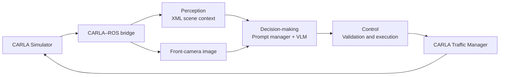

# VLM-based high-level action planner for mobile robots

A research framework for autonomous driving in **CARLA**, developed as a Master's Thesis for the MSc in Automatic Control and Robotics (MUAR) at the **Universitat Politècnica de Catalunya (UPC)**.

**Author:** Víctor Marín Jiménez · **Supervisor:** Vicenç Puig Cayuela · **Academic year:** 2025–2026

The project explores how a vision-language model (VLM) can make driving decisions from vehicle state, surrounding objects and a front-camera image. Three ROS 2 modules integrate the complete perception, decision-making and execution loop, using an external VLM served locally or in the cloud.

[Full thesis](docs/thesis/TFM_Victor.pdf) · [Getting started](docs/getting-started.md) · [Architecture](docs/architecture.md) · [Experiments and results](docs/experiments.md)

## Motivation and approach

Urban driving requires interpreting situations that are difficult to cover with predefined rules. This work investigates multimodal models as high-level planners, combining their ability to interpret context with a deterministic layer that executes actions and mitigates specific classes of model errors.

The architecture is **hierarchical and modular**: the VLM selects a semantic action and a target speed, while low-level control is delegated to **CARLA's Traffic Manager**. The framework covers the complete driving loop; the VLM does not directly generate throttle, brake or steering commands. No task-specific model training is required for the evaluated scenarios.

## How it works



| Module | Responsibility |
| --- | --- |
| `perception_module` | Aggregates speed, IMU, odometry, objects and traffic lights; publishes scene context at 1 Hz. |
| `decision_making_module` | Combines context, image and behavior prompt; queries the VLM and validates its JSON response. |
| `low_control_module` | Translates decisions into Traffic Manager commands and applies speed ramping, minimum action durations and a watchdog for missing decisions. |

The action space contains eight commands: `FOLLOW_LANE`, `SPEED_UP`, `SLOW_DOWN`, `STOP`, `TURN_LEFT`, `TURN_RIGHT`, `CHANGE_LANE_LEFT` and `CHANGE_LANE_RIGHT`.

Supported providers are **Ollama**, **OpenAI** and **OpenRouter**. The evaluation compares **Qwen3.5:2B served locally** with **Claude Haiku 4.5 through OpenRouter**. Context is published at 1 Hz; the effective decision rate depends on model response time.

## Evaluation and results

The evaluation used **Town10HD** and five scenarios: free driving, ambient traffic, a stationary obstacle, a crossing pedestrian and an approaching ambulance. Visual inspection was combined with analysis of model responses and the actions accepted by the controller.

| Aggregate metric | Qwen3.5:2B | Claude Haiku 4.5 |
| --- | ---: | ---: |
| Evaluated calls | 236 | 278 |
| Valid and complete responses | 91.5% | 100.0% |
| Fallback rate for invalid responses | 8.5% | 0.0% |
| Actions outside the allowed vocabulary | 11 | 0 |
| Median interval between responses | 5.0 s | 4.0 s |

Source: Chapter 4, Table 12 of the [thesis](docs/thesis/TFM_Victor.pdf), cross-checked against the [run summaries](docs/results/tablas_tesis.md). The interval between responses approximates loop timing; it is not an isolated inference-time measurement.

The observed runs show more consistent outputs from the reference model. The control layer narrows part of the gap between models by rejecting invalid actions and maintaining continuity during inference delays. **A well-formed response can still contain an incorrect driving decision**: the pedestrian scenario illustrates this boundary. Valid JSON does not establish correct driving behavior.

These results are exploratory: the study used one map and one run per model and scenario, except for a repeated obstacle test. Perception relies on ideal simulator data, and no ablation study isolated the contribution of the image. The ambulance scenario also exposes perception limitations when an emergency vehicle approaches from behind. Proposed extensions include goal-oriented navigation, action memory, more realistic perception and additional evaluation runs.

## Getting started

Reference stack: **Linux x86-64, Python 3.11, ROS 2 Humble, CARLA 0.9.16 and Pixi**. The simulator and VLM service are installed separately.

From the repository root:

```bash
cp .env.example .env
pixi install -e ros --locked
pixi run -e ros build_bridge
export CARLA_ROOT=/path/to/carla_0.9.16
```

With Ollama running and `qwen3.5:2b` downloaded, use separate terminals:

```bash
# Terminal 1: simulator
pixi run carla

# Terminal 2: bridge, ego vehicle and framework
pixi run -e ros launch

# Terminal 3: after the controller finds the hero vehicle
pixi run -e ros demo --scenario traffic
```

Startup preserves the experimental delays: the controller starts after 175 seconds. See the [execution guide](docs/getting-started.md) to change the provider, model, scenario or startup delays.

## Repository layout

```text
ros_ws/src/             Project packages and vendored ROS dependencies
carla_client_script/    Scenarios and simulation utilities
scripts/               Startup, build and run-analysis tools
config/                Visualization configuration
experiments/           Evaluation run selection
docs/                 Architecture, results and thesis
```

Environments, build products, credentials, recordings, editor settings and the local historical archive are excluded through `.gitignore`. New traces are written to `outputs/`. The complete historical run data is not distributed with the source.

## Documentation and attribution

- [Installation and execution](docs/getting-started.md)
- [Architecture and interfaces](docs/architecture.md)
- [Experiments, metrics and analysis reproduction](docs/experiments.md)
- [Thesis and bibliographic reference](docs/thesis/README.md)
- [Dependency provenance and modifications](THIRD_PARTY.md)
- [Maintenance plan and verification](docs/repository-maintenance.md)
- [Publication privacy and security review](docs/security-review.md)

The original project code and accompanying repository documentation are available under the [MIT License](LICENSE), allowing use, modification and redistribution, including commercial use. The thesis PDF is excluded from MIT and retains its [separate rights notice](docs/thesis/LICENSE). Vendored dependencies retain their own licenses; see the [licensing scope](docs/licensing.md).
